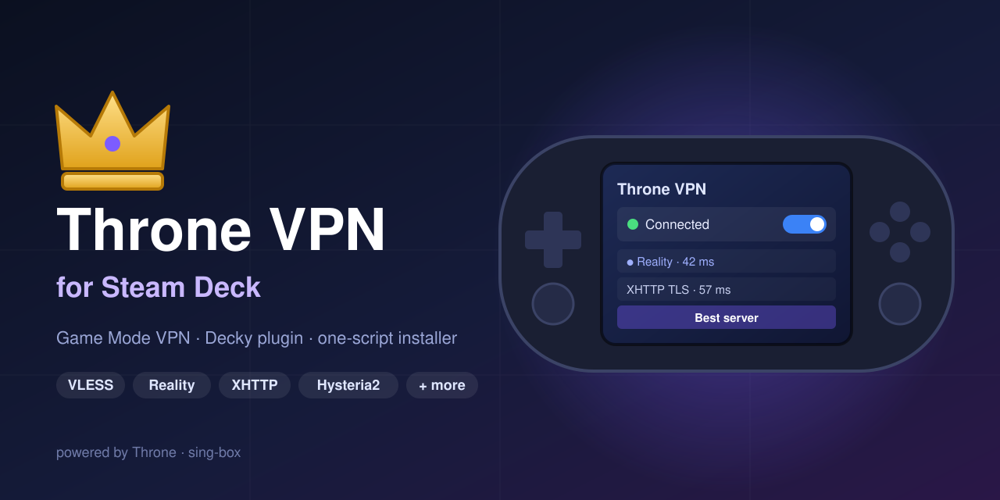

# VPN for Steam Deck / SteamOS — Throne Decky Game Mode Plugin

**English** · [Русский](README.ru.md)



> **Steam Deck / SteamOS port of [Throne](https://github.com/throneproj/Throne)**<br>
> One-script Desktop Mode installer + Decky Loader Game Mode VPN plugin.<br>
> Powered by [sing-box](https://github.com/SagerNet/sing-box) · Supports VLESS/Reality, XHTTP, VMess, Trojan, Hysteria 2, TUIC, Shadowsocks, WireGuard, AmneziaWG…

[](https://github.com/solidkeffir/decky-throne/releases/latest)
[](https://github.com/solidkeffir/decky-throne/releases)
[](https://github.com/throneproj/Throne)
[](https://store.steampowered.com/steamdeck)
[](https://decky.xyz)
[](LICENSE)

Throne VPN for Steam Deck gives you a VPN in both Desktop Mode and Game Mode with
[Throne](https://github.com/throneproj/Throne), a sing-box client with an excellent
subscription and routing engine. You download **one script**, run it in Desktop Mode, and it
installs Decky Loader, Throne and the Decky plugin, then opens the Throne window where you
paste your subscription link. After that the VPN is a toggle in the Quick Access menu.

The Decky plugin supports VPN on/off, subscription and server selection, latency tests,
"best server", subscription updates, routing profiles and TUN mode — all from Game Mode.

> Inspired by [**hiddify-steam-deck-vpn**](https://github.com/b-ostrov/hiddify-steam-deck-vpn),
> the Hiddify plugin for Steam Deck — see [Acknowledgements](#acknowledgements).

## 🌙 Need a server? M00NL3S5 VPN

Looking for a VPN subscription that works with this plugin out of the box? Try
**M00NL3S5 VPN**: VLESS + Reality and XHTTP on an up-to-date Xray server. The subscription
link goes straight into Throne, and the same subscription works on your phone and PC.

- 🤖 **Telegram bot: [@M00NL3S5VPNbot](https://t.me/M00NL3S5VPNbot)** — free 3-day trial,
  payment and your subscription link right in Telegram, from 150 ₽ a month
- 📢 **News channel: [@m00nl3s5VPN](https://t.me/m00nl3s5VPN)**

## Why Throne VPN on Steam Deck

This project is for Steam Deck users who want a VPN on SteamOS: for privacy on hotel,
campus or public Wi-Fi, a stable route to game servers, or their own VPN server.

Use Throne VPN for Steam Deck when you want:

- A Steam Deck VPN that works in both Desktop Mode and Game Mode
- A Decky VPN plugin that connects and disconnects without leaving Game Mode
- Subscription updates, server selection and latency tests from the Quick Access menu
- Modern protocols: VLESS + Reality, VLESS XHTTP, Hysteria 2, TUIC, Trojan, Shadowsocks, WireGuard, AmneziaWG
- Provider routing rules: Throne imports routing from subscriptions that send it (Happ format),
  for example "local sites go direct, the rest through the VPN"
- No password prompts and no `setcap`/`patchelf` hacks: Throne's official headless mode does the work

Common search terms: **Steam Deck VPN**, **VPN Steam Deck**, **SteamOS VPN**, **Decky VPN plugin**,
**Game Mode VPN**, **Throne Steam Deck**, **Throne SteamOS**, **sing-box Steam Deck**, **VLESS Steam Deck**.

## Latest Release

Latest stable build: **[v0.1.0](https://github.com/solidkeffir/decky-throne/releases/latest)**

- Installer: `throne-deck-install.sh` (~45 KB, the Decky plugin is inside)
- Throne itself is downloaded from [throneproj/Throne releases](https://github.com/throneproj/Throne/releases)
  at install time and checked against the release SHA-256

> First release: it has not been tested on real Steam Deck hardware yet.
> Reports in [Issues](https://github.com/solidkeffir/decky-throne/issues) are very welcome.

---

## Release Contents

| File | Description |
|------|-------------|
| `throne-deck-install.sh` | One-file installer (~45 KB). Installs Decky Loader if missing, the latest Throne, the bundled Decky plugin and a Throne desktop shortcut |

---

## Requirements

- Steam Deck (SteamOS 3.x), x86-64
- Internet access to GitHub during installation
  (or `Throne-<version>-linux-amd64.zip` placed in `~/Downloads`)
- A password for the `deck` user (`sudo`) — the installer offers to set one if there is none.
  Decky Loader cannot be installed without it.

---

## Installation

### 1. Download the installer in Desktop Mode

Open **Konsole** and run:

```bash
curl -L -o ~/throne-deck-install.sh \
  https://github.com/solidkeffir/decky-throne/releases/latest/download/throne-deck-install.sh
```

### 2. Run the installer

```bash
bash ~/throne-deck-install.sh
```

The installer automatically:

- Asks for the `sudo` password (offers to set one if `deck` has none)
- Installs [Decky Loader](https://decky.xyz) with its official installer, if it is not installed
- Downloads the latest `Throne-*-linux-amd64.zip` from GitHub and verifies its SHA-256
  (falls back to a ZIP in `~/Downloads` when GitHub is unreachable)
- Installs Throne to `~/homebrew/data/decky-throne/throne/` (owned by root)
- Installs the bundled Decky plugin to `~/homebrew/plugins/decky-throne/` and restarts Decky
- Waits for the plugin to start the `decky-throne` service
- Adds a **Throne** shortcut to the application menu and the desktop
- Opens the Throne window

Running the script again updates Throne and the plugin.

### 3. Add your subscription

In the Throne window:

1. Copy your subscription link (`https://…`).
2. Press **Ctrl+V** (or **Program → Add profile from clipboard**).
3. Choose **Create new subscription group** and press **OK**.
4. Quit Throne with **Program → Exit** (the window's close button only hides it to the tray).

Profiles are saved to `~/.config/Throne/` and are shared with Game Mode.

### 4. Use the Decky plugin in Game Mode

Return to Game Mode, press the `···` button, open **Decky**, then **Throne VPN** and turn the VPN on.

To edit subscriptions later, open the **Throne** shortcut in Desktop Mode. The plugin can also
add a subscription or `vless://` links right from Game Mode.

---

## Uninstall

```bash
bash ~/throne-deck-install.sh --uninstall
```

Removes:

- the `decky-throne` service, its unit and polkit rule
- the Decky plugin and the Throne binaries (`~/homebrew/data/decky-throne/`)
- the Throne shortcut from `~/.local/share/applications/` and the desktop

Your profiles stay in `~/.config/Throne/` — delete the folder yourself if you do not need them.
Decky Loader stays installed.

---

## VPN Control from Terminal

```bash
# Service status / restart
systemctl status decky-throne
sudo systemctl restart decky-throne

# Live logs
journalctl -u decky-throne -f

# Full control through the Throne API with thronectl (bundled with Throne)
alias thronectl="$HOME/homebrew/data/decky-throne/throne/thronectl \
  --addr 127.0.0.1:9096 --key-file $HOME/.config/Throne/config/api.key"
thronectl status
thronectl profiles
thronectl connect best
thronectl disconnect
```

---

## Troubleshooting

| Symptom | What to do |
|---------|------------|
| Subscription update fails with 404 / "No profiles found" | Your provider may limit devices and require a device ID. In the Throne window: **Settings → Basic Settings → Subscription → Enable sending HWID, device model, and OS version when updating subscription** (off by default in Throne; if you do not see it, switch **Settings → Basic Settings → Style → Interface** to **Advanced**), then update the group. Some providers also need a specific **User Agent** there (`Happ/1.0`, `sing-box`, `ClashMeta`) |
| VLESS + Reality fails with `reality verification failed` | Xray 26.9.9+ servers require the X25519MLKEM768 key exchange, which the Reality client of sing-box lacks. Throne runs Reality on its bundled **Xray** core by default: keep **Settings → Basic Settings → Core → Xray VLESS Preference** at **XHTTP And Reality** (or **All VLESS**), update the subscription and check that the profile type is `VLESS (Xray)`. See [Throne docs](https://throneproj.github.io/advanced/xray/#reality) |
| Plugin says "The Throne window is open" | Quit the window with **Program → Exit** in Desktop Mode |
| Plugin says the service is not running | Press **Restart Throne**, or check `journalctl -u decky-throne -n 100` |
| TUN conflict | Another VPN (or another Throne) holds TUN: stop it, then reconnect |

---

## Technical Details

### Files

```
~/homebrew/data/decky-throne/throne/      # Throne from the official Linux ZIP (root-owned)
├── Throne                                # Qt app: desktop window and --headless service
├── ThroneCore                            # sing-box based core
├── thronectl                             # Throne API command-line client
└── usr/lib, usr/plugins                  # bundled Qt libraries
~/homebrew/plugins/decky-throne/          # the Decky plugin
~/.config/Throne/                         # profiles, settings, API key — shared with the window
~/.local/share/decky-throne/throne-gui.sh # shortcut wrapper
/etc/systemd/system/decky-throne.service
/etc/polkit-1/rules.d/49-decky-throne.rules
```

### Key Port Fixes

| Problem | Solution |
|---------|----------|
| TUN needs root, SteamOS has no password by default | The service runs Throne as `deck` with ambient network capabilities (`CAP_NET_ADMIN`…), exactly like Throne's own `dist/linux/caps.conf`. No `setcap`, no setuid, no sudo at runtime |
| Game Mode cannot show a desktop app | Throne's official **headless mode** (Throne 1.4+) runs as a systemd service; the plugin drives it through the **Throne API** |
| Desktop window and Game Mode must share subscriptions | Both use `~/.config/Throne` (window: `Throne -appdata`, service: `--data-dir`) |
| Two Thrones cannot use one data folder at once | The **Throne** shortcut stops the service, opens the window and starts the service after **Exit**; a polkit rule lets `deck` do that without a password |
| Window killed by switching to Game Mode before it could restart the service | The plugin checks every 15 s and starts the service once no Throne window is running |
| Throne window asked for TUN privileges and made `ThroneCore` setuid (clears ambient caps) | The plugin resets `ThroneCore` to a plain root-owned 0755 file before each start |
| Decky's Python has no `cryptography` for the encrypted Throne API | ChaCha20-Poly1305 and the API wire protocol are implemented in pure Python and checked against the official test vectors |
| Decky's `LD_LIBRARY_PATH` breaks `systemctl` and `journalctl` | Subprocesses run with a clean environment |
| HTTPS downloads fail with Decky's bundled Python | `certifi` from Decky, then the SteamOS CA bundle |
| Game Mode has no paste | **Paste** in the plugin falls back to `~/throne.txt` |
| A desktop Throne with its API on would clash on port 9095 | The service listens on `127.0.0.1:9096` |
| VPN drops when Decky restarts | Throne is a separate service; the plugin only talks to it |

### Why Installation Survives SteamOS Updates

Throne, the plugin and your profiles live in `/home`, which SteamOS updates do not touch.
The systemd unit and the polkit rule live in `/etc`; the plugin rewrites both every time Decky
loads it, so they come back even if an update resets `/etc`.

---

## Decky Plugin (v0.1.0)

The plugin adds VPN control to the Quick Access menu (the `···` button).

### Features

- **VPN ON / OFF toggle** with the current server, its latency and live ↓/↑ speed
- **Subscription selector** and the **server list** with latency and country flags
- **Best server** — tests latency and connects the fastest server
- **Test latency** and **Update subscription**
- **Add subscription or links** — `https://` subscriptions or `vless://`, `ss://`, `trojan://`, `hy2://` links,
  with **routing rules from the subscription** (Happ format)
- **Routing profile** selector
- **TUN** (all traffic) or proxy-only mode on `127.0.0.1:2080`
- **Connect when the Deck starts**
- **Log viewer**, **Restart Throne**, **Update Throne** (checks GitHub, verifies SHA-256)
- Installs Throne by itself if it is missing
- Shows a hint when the Throne window is open in Desktop Mode
- English and Russian interface

### Plugin Architecture

```
decky-throne/
├── main.py                 # Backend (Python, root): installs Throne, writes the unit, calls the API
├── py_modules/throne_api.py  # Throne API client: wire protocol v1, ChaCha20-Poly1305
├── src/index.tsx           # Frontend (React/TSX): Quick Access panel
├── src/i18n.ts             # English / Russian strings
└── installer/install.sh.in # Desktop Mode installer template (build.sh embeds the plugin)
```

The plugin never edits Throne's database: every action — connect, test, update, import —
is a Throne API request, so the desktop window and Game Mode always agree.

---

## Comparison with the Hiddify plugin

| | [hiddify-steam-deck-vpn](https://github.com/b-ostrov/hiddify-steam-deck-vpn) | Throne VPN for Steam Deck |
|---|---|---|
| Client | Hiddify (Flutter) | [Throne](https://github.com/throneproj/Throne) (Qt) |
| Game Mode control | `HiddifyCli` + generated sing-box config | Throne's official headless mode + Throne API |
| TUN privileges | `setcap` + passwordless sudoers entry | ambient capabilities of a systemd service |
| Installer | self-extracting `.bin` (~51 MB) | `.sh` (~45 KB), Throne downloaded and SHA-256 checked |
| Server list in Game Mode | parsed from the generated config | Throne's profiles with latency, best server |

---

## Build from Source

```bash
npm install
./build.sh
# Output: out/throne-deck-install.sh (the plugin is embedded)
```

Tests:

```bash
python3 tests/test_protocol.py                 # Throne API wire protocol vs official vectors
python3 tests/smoke_fake.py /path/to/fake.key  # plugin backend vs fakethrone from Throne-api
```

`fakethrone` comes from [Throne-api](https://github.com/throneproj/Throne-api):
`go run ./internal/fakethrone/cmd -listen 127.0.0.1:9096 -key-file fake.key`.

---

## Acknowledgements

- [**hiddify-steam-deck-vpn**](https://github.com/b-ostrov/hiddify-steam-deck-vpn) by b-ostrov — the
  Hiddify VPN plugin for Steam Deck. This project started from it as a reference: the idea of a
  Desktop Mode installer plus a Game Mode Decky plugin, the layout of this README and lessons such
  as Decky's `LD_LIBRARY_PATH` and CA bundle pitfalls. The code here is written from scratch for Throne.
- [Throne](https://github.com/throneproj/Throne) and [Throne-api](https://github.com/throneproj/Throne-api)
  — the client, its headless mode, API, `thronectl` and the protocol test vectors (`tests/vectors_v1.json`, MIT).
- [Decky Loader](https://github.com/SteamDeckHomebrew/decky-loader) and
  [decky-plugin-template](https://github.com/SteamDeckHomebrew/decky-plugin-template).
- [sing-box](https://github.com/SagerNet/sing-box).

## Sources

- Throne: https://github.com/throneproj/Throne
- Headless Throne docs: https://throneproj.github.io/headless/
- Throne API: https://github.com/throneproj/Throne-api
- Decky Loader: https://github.com/SteamDeckHomebrew/decky-loader
- Reference plugin: https://github.com/b-ostrov/hiddify-steam-deck-vpn

## License

[BSD 3-Clause](LICENSE). Throne is GPL-3.0 and is downloaded from its official releases, not
redistributed here.
