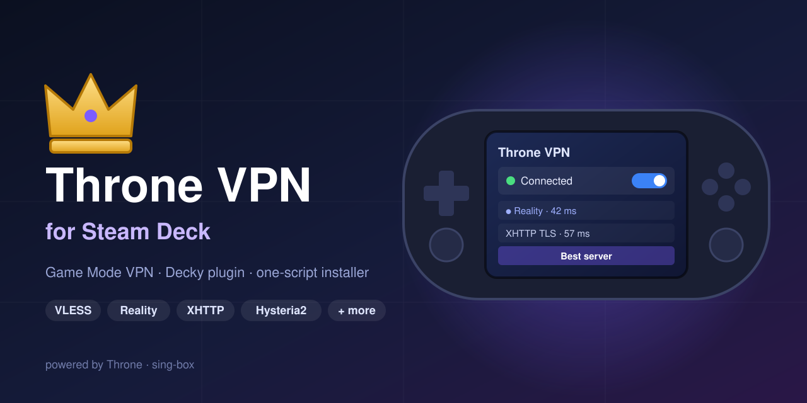

# VPN для Steam Deck / SteamOS — плагин Throne для игрового режима (Decky)

[English](README.md) · **Русский**



> **Порт [Throne](https://github.com/throneproj/Throne) для Steam Deck / SteamOS**<br>
> Установщик одним скриптом для режима рабочего стола + плагин Decky Loader для игрового режима.<br>
> Ядро [sing-box](https://github.com/SagerNet/sing-box) и Xray · VLESS/Reality, XHTTP, VMess, Trojan, Hysteria 2, TUIC, Shadowsocks, WireGuard, AmneziaWG…

[](https://github.com/solidkeffir/decky-throne/releases/latest)
[](https://github.com/solidkeffir/decky-throne/releases)
[](https://github.com/throneproj/Throne)
[](https://store.steampowered.com/steamdeck)
[](https://decky.xyz)
[](LICENSE)

Throne VPN для Steam Deck — это VPN и в режиме рабочего стола, и в игровом режиме на базе
[Throne](https://github.com/throneproj/Throne), клиента на sing-box с отличной работой с
подписками и маршрутизацией. Вы скачиваете **один скрипт** и запускаете его в режиме рабочего
стола. Он ставит Decky Loader, Throne и плагин, а потом открывает окно Throne, куда вы вставляете
ссылку на подписку. Дальше VPN — переключатель в меню быстрого доступа.

Плагин Decky умеет включать и выключать VPN, выбирать подписку и сервер, проверять пинг,
подключать «лучший сервер», обновлять подписки, менять профиль маршрутизации и режим TUN —
всё из игрового режима.

> По мотивам [**hiddify-steam-deck-vpn**](https://github.com/b-ostrov/hiddify-steam-deck-vpn),
> плагина Hiddify для Steam Deck — см. [Благодарности](#благодарности).

## 🌙 Нужен сервер? M00NL3S5 VPN

Ищете подписку, которая сразу работает с этим плагином? Попробуйте **M00NL3S5 VPN**:
VLESS + Reality и XHTTP на свежем Xray. Ссылка на подписку вставляется прямо в Throne,
и та же подписка работает на телефоне и компьютере.

- 🤖 **Telegram-бот: [@M00NL3S5VPNbot](https://t.me/M00NL3S5VPNbot)** — пробный период 3 дня
  бесплатно, оплата и ссылка на подписку прямо в Telegram, от 150 ₽ в месяц
- 📢 **Канал с новостями: [@m00nl3s5VPN](https://t.me/m00nl3s5VPN)**

## Зачем Throne VPN на Steam Deck

Проект для тех, кому на SteamOS нужен VPN: для приватности в отеле, кампусе или публичном
Wi-Fi, для стабильного маршрута до игровых серверов или для своего VPN-сервера.

Throne VPN для Steam Deck подойдёт, если вам нужно:

- VPN на Steam Deck, который работает и в режиме рабочего стола, и в игровом режиме
- плагин Decky, который подключает и отключает VPN, не выходя из игрового режима
- обновление подписок, выбор сервера и проверка пинга из меню быстрого доступа
- современные протоколы: VLESS + Reality, VLESS XHTTP, Hysteria 2, TUIC, Trojan, Shadowsocks, WireGuard, AmneziaWG
- правила маршрутизации от провайдера: Throne берёт их из подписки (формат Happ), например
  «местные сайты напрямую, остальное через VPN»
- никаких запросов пароля и трюков с `setcap`/`patchelf`: всё делает официальный headless-режим Throne

Что ищут: **VPN Steam Deck**, **VPN для Steam Deck**, **SteamOS VPN**, **Decky VPN плагин**,
**VPN в игровом режиме**, **Throne Steam Deck**, **sing-box Steam Deck**, **VLESS Steam Deck**.

## Последний релиз

Последняя версия: **[v0.1.0](https://github.com/solidkeffir/decky-throne/releases/latest)**

- Установщик: `throne-deck-install.sh` (~45 КБ, плагин Decky внутри)
- Сам Throne скачивается при установке из [релизов throneproj/Throne](https://github.com/throneproj/Throne/releases)
  и сверяется с SHA-256 релиза

> Первый релиз: на настоящем Steam Deck ещё не проверялся.
> Пишите в [Issues](https://github.com/solidkeffir/decky-throne/issues), что получилось и что нет.

---

## Что в релизе

| Файл | Описание |
|------|----------|
| `throne-deck-install.sh` | Установщик одним файлом (~45 КБ). Ставит Decky Loader (если его нет), последний Throne, встроенный плагин Decky и ярлык Throne |

---

## Требования

- Steam Deck (SteamOS 3.x), x86-64
- Доступ к GitHub во время установки
  (или `Throne-<версия>-linux-amd64.zip` в папке «Загрузки»)
- Пароль пользователя `deck` (`sudo`) — если его нет, установщик предложит задать.
  Без пароля Decky Loader не установить.

---

## Установка

### 1. Скачайте установщик в режиме рабочего стола

Откройте **Konsole** и выполните:

```bash
curl -L -o ~/throne-deck-install.sh \
  https://github.com/solidkeffir/decky-throne/releases/latest/download/throne-deck-install.sh
```

### 2. Запустите установщик

```bash
bash ~/throne-deck-install.sh
```

Установщик сам:

- попросит пароль `sudo` (если у `deck` пароля нет — предложит задать)
- поставит [Decky Loader](https://decky.xyz) официальным установщиком, если его ещё нет
- скачает последний `Throne-*-linux-amd64.zip` с GitHub и сверит SHA-256
  (если GitHub недоступен — возьмёт ZIP из «Загрузок»)
- установит Throne в `~/homebrew/data/decky-throne/throne/` (владелец root)
- установит встроенный плагин в `~/homebrew/plugins/decky-throne/` и перезапустит Decky
- дождётся, пока плагин запустит службу `decky-throne`
- добавит ярлык **Throne** в меню приложений и на рабочий стол
- откроет окно Throne

Повторный запуск скрипта обновляет Throne и плагин.

### 3. Добавьте подписку

В окне Throne:

1. Скопируйте ссылку на подписку (`https://…`).
2. Нажмите **Ctrl+V** (или **Программа → Добавить профиль из буфера обмена**).
3. Выберите **Создать новую группу подписки** и нажмите **OK**.
4. Закройте Throne через **Программа → Выход** (крестик окна только сворачивает в трей).

Профили сохраняются в `~/.config/Throne/` и общие с игровым режимом.

### 4. Пользуйтесь плагином в игровом режиме

Вернитесь в игровой режим, нажмите кнопку `···`, откройте **Decky** → **Throne VPN** и включите VPN.

Чтобы потом поменять подписки, откройте ярлык **Throne** в режиме рабочего стола. Добавить подписку
или ссылки `vless://` можно и прямо из игрового режима, в плагине.

---

## Удаление

```bash
bash ~/throne-deck-install.sh --uninstall
```

Удаляет:

- службу `decky-throne`, её юнит и правило polkit
- плагин Decky и файлы Throne (`~/homebrew/data/decky-throne/`)
- ярлык Throne из `~/.local/share/applications/` и с рабочего стола

Профили остаются в `~/.config/Throne/` — удалите папку сами, если они не нужны.
Decky Loader остаётся.

---

## Управление VPN из терминала

```bash
# Состояние и перезапуск службы
systemctl status decky-throne
sudo systemctl restart decky-throne

# Журнал в реальном времени
journalctl -u decky-throne -f

# Полное управление через Throne API программой thronectl (идёт в комплекте с Throne)
alias thronectl="$HOME/homebrew/data/decky-throne/throne/thronectl \
  --addr 127.0.0.1:9096 --key-file $HOME/.config/Throne/config/api.key"
thronectl status
thronectl profiles
thronectl connect best
thronectl disconnect
```

---

## Проблемы и решения

| Что случилось | Что делать |
|---------------|------------|
| Подписка не обновляется: 404 или «В подписке не найдено профилей» | Возможно, провайдер ограничивает число устройств и требует идентификатор устройства. В окне Throne: **Настройки → Основные настройки → Подписка → Включить отправку HWID, модели устройства и версии ОС при обновлении подписки** (в Throne по умолчанию выключено; если пункта не видно, включите **Настройки → Основные настройки → Интерфейс → Расширенный**), затем обновите группу. Некоторым провайдерам нужен и определённый **User Agent** там же (`Happ/1.0`, `sing-box`, `ClashMeta`) |
| VLESS + Reality не подключается, в журнале `reality verification failed` | Серверы Xray 26.9.9 и новее требуют обмен ключами X25519MLKEM768, которого нет в Reality-клиенте sing-box. Throne по умолчанию запускает Reality на встроенном ядре **Xray**: оставьте **Настройки → Основные настройки → Ядро → Предпочтение Xray для VLESS** = **XHTTP And Reality** (или **All VLESS**), обновите подписку и проверьте, что тип профиля — `VLESS (Xray)`. См. [документацию Throne](https://throneproj.github.io/advanced/xray/#reality) |
| Плагин пишет «Открыто окно Throne» | Закройте окно в режиме рабочего стола через **Программа → Выход** |
| Плагин пишет, что служба не запущена | Нажмите **Перезапустить Throne** или посмотрите `journalctl -u decky-throne -n 100` |
| «TUN занят другой программой» | TUN держит другой VPN (или другой Throne): остановите его и переподключитесь |

---

## Технические детали

### Файлы

```
~/homebrew/data/decky-throne/throne/      # Throne из официального Linux ZIP (владелец root)
├── Throne                                # Qt-приложение: окно и служба --headless
├── ThroneCore                            # ядро на sing-box со встроенным Xray
├── thronectl                             # клиент Throne API для командной строки
└── usr/lib, usr/plugins                  # библиотеки Qt
~/homebrew/plugins/decky-throne/          # плагин Decky
~/.config/Throne/                         # профили, настройки, ключ API — общие с окном
~/.local/share/decky-throne/throne-gui.sh # обёртка для ярлыка
/etc/systemd/system/decky-throne.service
/etc/polkit-1/rules.d/49-decky-throne.rules
```

### Ключевые решения

| Проблема | Решение |
|----------|---------|
| TUN нужны права root, а в SteamOS по умолчанию нет пароля | Служба запускает Throne от `deck` с сетевыми ambient capabilities (`CAP_NET_ADMIN`…) — так же, как официальный `dist/linux/caps.conf` Throne. Ни `setcap`, ни setuid, ни sudo во время работы |
| Игровой режим не показывает окна приложений | Официальный **headless-режим** Throne (1.4+) работает службой systemd, плагин управляет им через **Throne API** |
| Окно и игровой режим должны видеть одни подписки | Оба используют `~/.config/Throne` (окно: `Throne -appdata`, служба: `--data-dir`) |
| Два Throne не могут одновременно работать с одной папкой данных | Ярлык **Throne** останавливает службу, открывает окно и запускает службу после **Выхода**; правило polkit разрешает `deck` делать это без пароля |
| Окно закрылось вместе с режимом рабочего стола и не успело запустить службу | Плагин раз в 15 с проверяет и запускает службу, когда окна Throne нет |
| Окно Throne при запросе прав для TUN делает `ThroneCore` setuid (а это сбрасывает ambient capabilities) | Перед каждым запуском плагин возвращает `ThroneCore` обычные права root 0755 |
| В Python у Decky нет `cryptography` для шифрованного Throne API | ChaCha20-Poly1305 и протокол API написаны на чистом Python и проверены официальными тестовыми векторами |
| `LD_LIBRARY_PATH` из Decky ломает `systemctl` и `journalctl` | Внешние команды запускаются с чистым окружением |
| HTTPS-загрузки падают во встроенном Python Decky | `certifi` из Decky, затем системные сертификаты SteamOS |
| В игровом режиме нет вставки | Кнопка **Вставить** в плагине берёт текст из `~/throne.txt`, если буфер недоступен |
| Throne на рабочем столе с включённым API занял бы порт 9095 | Служба слушает `127.0.0.1:9096` |
| VPN отключается при перезапуске Decky | Throne — отдельная служба, плагин только общается с ней |

### Почему установка переживает обновления SteamOS

Throne, плагин и профили лежат в `/home`, его обновления SteamOS не трогают.
Юнит systemd и правило polkit лежат в `/etc`; плагин переписывает их при каждой загрузке
Decky, так что они вернутся, даже если обновление сбросит `/etc`.

---

## Плагин Decky (v0.1.0)

Плагин добавляет управление VPN в меню быстрого доступа (кнопка `···`).

### Возможности

- **Переключатель VPN** с текущим сервером, пингом и скоростью ↓/↑
- **Выбор подписки** и **список серверов** с пингом и флагами стран
- **Лучший сервер** — проверяет пинг и подключает самый быстрый
- **Проверить пинг** и **Обновить подписку**
- **Добавить подписку или ссылки** — подписки `https://` или ссылки `vless://`, `ss://`, `trojan://`, `hy2://`,
  с **правилами маршрутизации из подписки** (формат Happ)
- Выбор **профиля маршрутизации**
- **TUN** (весь трафик) или только прокси `127.0.0.1:2080`
- **Подключать при включении Deck**
- **Журнал**, **Перезапустить Throne**, **Обновить Throne** (проверяет GitHub, сверяет SHA-256)
- Сам ставит Throne, если его нет
- Подсказывает, если окно Throne открыто в режиме рабочего стола
- Интерфейс на русском и английском

### Устройство плагина

```
decky-throne/
├── main.py                   # Бэкенд (Python, root): ставит Throne, пишет юнит, вызывает API
├── py_modules/throne_api.py  # Клиент Throne API: протокол v1, ChaCha20-Poly1305
├── src/index.tsx             # Фронтенд (React/TSX): панель быстрого доступа
├── src/i18n.ts               # Тексты на русском и английском
└── installer/install.sh.in   # Шаблон установщика (build.sh вшивает в него плагин)
```

Плагин никогда не правит базу Throne напрямую: каждое действие — подключение, проверка,
обновление, импорт — это запрос к Throne API, поэтому окно и игровой режим всегда согласованы.

---

## Сравнение с плагином Hiddify

| | [hiddify-steam-deck-vpn](https://github.com/b-ostrov/hiddify-steam-deck-vpn) | Throne VPN для Steam Deck |
|---|---|---|
| Клиент | Hiddify (Flutter) | [Throne](https://github.com/throneproj/Throne) (Qt) |
| Управление из игрового режима | `HiddifyCli` + сгенерированный конфиг sing-box | официальный headless-режим Throne + Throne API |
| Права для TUN | `setcap` + запись в sudoers без пароля | ambient capabilities службы systemd |
| Установщик | самораспаковывающийся `.bin` (~51 МБ) | `.sh` (~45 КБ), Throne скачивается и сверяется по SHA-256 |
| Список серверов в игровом режиме | разбирается из сгенерированного конфига | профили Throne с пингом и «лучшим сервером» |

---

## Сборка из исходников

```bash
npm install
./build.sh
# Результат: out/throne-deck-install.sh (плагин вшит внутрь)
```

Тесты:

```bash
python3 tests/test_protocol.py                 # протокол Throne API против официальных векторов
python3 tests/smoke_fake.py /path/to/fake.key  # бэкенд плагина против fakethrone из Throne-api
```

`fakethrone` — из [Throne-api](https://github.com/throneproj/Throne-api):
`go run ./internal/fakethrone/cmd -listen 127.0.0.1:9096 -key-file fake.key`.

---

## Благодарности

- [**hiddify-steam-deck-vpn**](https://github.com/b-ostrov/hiddify-steam-deck-vpn) от b-ostrov — плагин
  Hiddify VPN для Steam Deck. Этот проект начинался с него как с образца: идея «установщик в режиме
  рабочего стола + плагин Decky для игрового режима», структура этого README и найденные там грабли —
  `LD_LIBRARY_PATH` и сертификаты во встроенном Python Decky. Код здесь написан с нуля под Throne.
- [Throne](https://github.com/throneproj/Throne) и [Throne-api](https://github.com/throneproj/Throne-api) —
  клиент, его headless-режим, API, `thronectl` и тестовые векторы протокола (`tests/vectors_v1.json`, MIT).
- [Decky Loader](https://github.com/SteamDeckHomebrew/decky-loader) и
  [decky-plugin-template](https://github.com/SteamDeckHomebrew/decky-plugin-template).
- [sing-box](https://github.com/SagerNet/sing-box).

## Ссылки

- Throne: https://github.com/throneproj/Throne
- Документация headless Throne: https://throneproj.github.io/headless/
- Throne API: https://github.com/throneproj/Throne-api
- Decky Loader: https://github.com/SteamDeckHomebrew/decky-loader
- Плагин-образец: https://github.com/b-ostrov/hiddify-steam-deck-vpn

## Лицензия

[BSD 3-Clause](LICENSE). Throne распространяется под GPL-3.0 и скачивается из его официальных
релизов, здесь он не распространяется.
